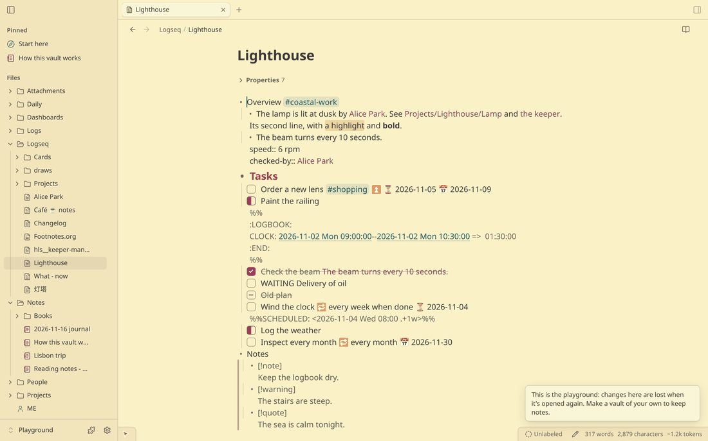
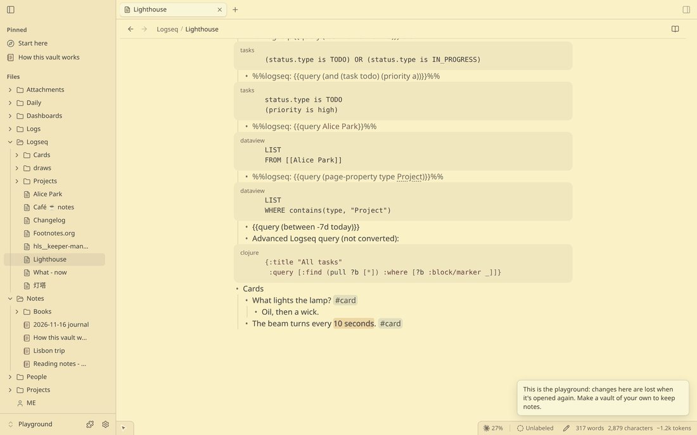
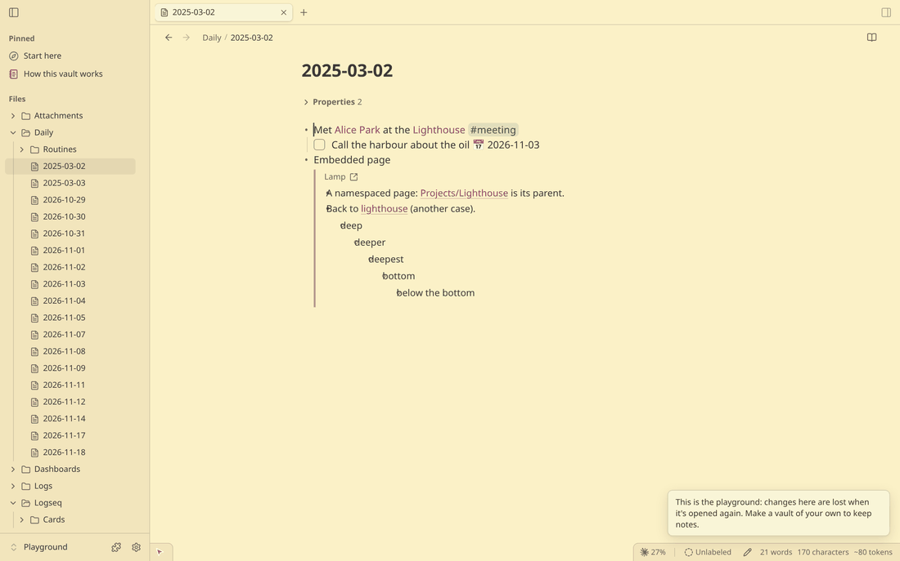
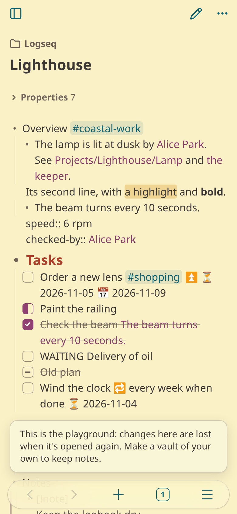

# Logseq plugin: test report

The Logseq plugin imports a Logseq graph into a vault and exports vault notes back as a Logseq graph. This report says
what was tested, on which graphs, what converts, what doesn't, and how long it took. Every run used a throwaway server
(testkit: a sandbox vault on a port in 8930-8939). No real vault was touched.

## How each graph was checked
For each graph, `logseq/.test/check.ts` did all of this on a fresh throwaway server:

1. Imported the graph with `logseq.import` and timed it.
2. Compared the job's counts with the source: pages and journals.
3. Read every imported note's frontmatter with the app's own parser. A note that fails to parse is a failure.
4. Resolved every link and embed with the app's own link resolver (`core/links.ts`). A link that finds nothing while the
   graph has that page is a failure. A link to a page no file has (Logseq makes those pages on the fly) is counted
   apart. A block link `[[Page#^id]]` must find a note with that `^id`. A `((uuid))` left in a note must not be a block
   of the graph.
5. Rendered every imported note through `/api/render`.
6. Imported the graph again and checked that nothing was created and no file in the vault changed (by hash).
7. Exported the folder with `logseq.export` and compared every page and journal with the source, block by block, after
   writing both the same way (see "Round trip" below). Timed it.

`node test.ts logseq` runs the same checks on four made-up graphs (Alice Park, Lighthouse) plus unit checks and
graph-specific checks. `logseq/.test/graphs.ts` runs them on any graphs given; that is how the tables below were made.
`logseq/.test/qa/import.mjs` drives the app in a browser.

## Graphs
Fifteen public graphs were cloned at test time into `/var/tmp` and deleted afterwards. None is committed. Six more
were made up: three small fixtures and three generated graphs. Sizes count the whole folder (assets too).

| Graph | Source | Size | Pages | Journals | Blocks | Assets | Org pages | Links resolved | Queries converted | Rendered | Imported again | Round trip | Import | Export | Failures |
|---|---|---|---|---|---|---|---|---|---|---|---|---|---|---|---|
| logseq-docs | [logseq/docs](https://github.com/logseq/docs) | 207.1 MB | 243 | 91 | 6510 | 151 | 20 | 1266 of 2398 (1132 to no page) | 13 of 36 | 336 of 336 | 0 new, 0 changed | 331 of 334 | 1.5 s | 1.0 s | 0 |
| logseq-exporter-test | [logseq/logseq](https://github.com/logseq/logseq) test graph (`deps/graph-parser/test/resources/exporter-test-graph`) | 7.3 MB | 24 | 30 | 161 | 10 | 0 | 32 of 64 (32 to no page) | 2 of 4 | 55 of 55 | 0 new, 0 changed | 54 of 54 | 0.8 s | 0.2 s | 0 |
| candideu-demo | [candideu/Logseq-Demo-Graph](https://github.com/candideu/Logseq-Demo-Graph) | 2.7 MB | 10 | 1 | 568 | 1 | 0 | 52 of 56 (4 to no page) | 0 of 0 | 13 of 13 | 0 new, 0 changed | 11 of 11 | 0.5 s | 0.2 s | 0 |
| ulysses | [QWxleA/ulysses-logseq](https://github.com/QWxleA/ulysses-logseq) | 34.5 MB | 59 | 0 | 6174 | 4 | 0 | 62 of 65 (3 to no page) | 0 of 0 | 59 of 59 | 0 new, 0 changed | 58 of 59 | 0.8 s | 0.2 s | 0 |
| inbo-guidelines | [inbo/guidelines-monitoring-networks](https://github.com/inbo/guidelines-monitoring-networks) | 0.3 MB | 47 | 4 | 277 | 5 | 0 | 66 of 68 (2 to no page) | 0 of 0 | 51 of 51 | 0 new, 0 changed | 51 of 51 | 0.5 s | 0.1 s | 0 |
| karlicoss-exobrain | [karlicoss/exobrain](https://github.com/karlicoss/exobrain) (Org) | 3.1 MB | 132 | 0 | 9620 | 0 | 132 | 143 of 192 (49 to no page) | 0 of 0 | 132 of 132 | 0 new, 0 changed | 39 of 132 | 1.2 s | 0.5 s | 0 |
| yurrriq-category-theory | [yurrriq/brain](https://github.com/yurrriq/brain) `category-theory` (Org) | 0.2 MB | 44 | 0 | 66 | 5 | 39 | 141 of 145 (4 to no page) | 0 of 0 | 44 of 44 | 0 new, 0 changed | 33 of 44 | 0.5 s | 0.2 s | 0 |
| space-engineering | [ulfkemmsies/space-engineering-knowledge-garden](https://github.com/ulfkemmsies/space-engineering-knowledge-garden) (Markdown and Org) | 0.1 MB | 5 | 1 | 84 | 2 | 5 | 4 of 15 (11 to no page) | 0 of 0 | 6 of 6 | 0 new, 0 changed | 6 of 6 | 0.4 s | 0.1 s | 0 |
| devsecops-pkm | [jtigger/devsecops-pkm](https://github.com/jtigger/devsecops-pkm) | 0.1 MB | 34 | 26 | 599 | 0 | 0 | 46 of 65 (19 to no page) | 0 of 0 | 60 of 60 | 0 new, 0 changed | 60 of 60 | 0.4 s | 0.1 s | 0 |
| dnd-graph | [bgrolleman/logseq_dnd_graph](https://github.com/bgrolleman/logseq_dnd_graph) | 0.1 MB | 19 | 1 | 105 | 0 | 0 | 25 of 40 (15 to no page) | 6 of 8 | 20 of 20 | 0 new, 0 changed | 20 of 20 | 0.4 s | 0.1 s | 0 |
| lingmeth | [wuqui/lingmeth](https://github.com/wuqui/lingmeth) (Org) | 94.9 MB | 67 | 1 | 914 | 62 | 66 | 155 of 246 (91 to no page) | 2 of 2 | 66 of 66 | 0 new, 0 changed | 59 of 68 | 0.8 s | 0.2 s | 0 |
| personal-logseq | [dgodovich/personal_logseq](https://github.com/dgodovich/personal_logseq) | 84.2 MB | 437 | 71 | 14065 | 235 | 0 | 986 of 2454 (1468 to no page) | 0 of 0 | 510 of 510 | 0 new, 0 changed | 508 of 508 | 2.1 s | 0.6 s | 0 |
| tu-bs | [Callisto95/logseq-TU-BS](https://github.com/Callisto95/logseq-TU-BS) (German, math) | 6.1 MB | 228 | 0 | 8948 | 41 | 0 | 345 of 351 (6 to no page) | 0 of 0 | 228 of 228 | 0 new, 0 changed | 226 of 228 | 1.1 s | 0.3 s | 0 |
| guppiz-notes | [guppiz/logseq-notes](https://github.com/guppiz/logseq-notes) | 4.5 MB | 27 | 107 | 1111 | 8 | 0 | 42 of 121 (79 to no page) | 0 of 0 | 136 of 136 | 0 new, 0 changed | 134 of 134 | 0.7 s | 0.2 s | 0 |
| greek-myth | [andelf/logseq-graph-of-greek-myth](https://github.com/andelf/logseq-graph-of-greek-myth) (Chinese; pages only, its 950 MB of pictures left out) | 0.5 MB | 783 | 0 | 16027 | 0 | 0 | 5014 of 5642 (628 to no page) | 2 of 2 | 783 of 783 | 0 new, 0 changed | 783 of 783 | 1.6 s | 0.5 s | 0 |
| lighthouse | made up: most of Logseq's syntax | 0 MB | 9 | 2 | 68 | 5 | 2 | 30 of 34 (4 to no page) | 4 of 6 | 11 of 11 | 0 new, 0 changed | 11 of 11 | 0.5 s | 0.2 s | 0 |
| legacy | made up: legacy file names, LATER/NOW, spaces for indentation | 0 MB | 3 | 2 | 10 | 0 | 0 | 3 of 3 (0 to no page) | 0 of 0 | 5 of 5 | 0 new, 0 changed | 5 of 5 | 0.5 s | 0.1 s | 0 |
| dbexport | made up: the DB version's Markdown export (zip) | 0 MB | 3 | 1 | 6 | 0 | 0 | 4 of 4 (0 to no page) | 0 of 0 | 4 of 4 | 0 new, 0 changed | 4 of 4 | 0.4 s | 0.1 s | 0 |
| deep | generated: outlines 40 levels deep | 0.3 MB | 200 | 10 | 4330 | 0 | 0 | 3010 of 3010 (0 to no page) | 0 of 0 | 210 of 210 | 0 new, 0 changed | 210 of 210 | 1.0 s | 0.3 s | 0 |
| assets | generated: 3,000 assets | 0.1 MB | 300 | 30 | 1290 | 300 | 0 | 1130 of 1130 (0 to no page) | 0 of 0 | 330 of 330 | 0 new, 0 changed | 330 of 330 | 1.2 s | 0.3 s | 0 |
| large | generated: 10,000 pages, 1,500 journals, unicode titles | 4.8 MB | 10000 | 1500 | 79784 | 300 | 0 | 58456 of 58456 (0 to no page) | 0 of 0 | 11500 of 11500 | 0 new, 0 changed | 11500 of 11500 | 31.3 s | 4.9 s | 0 |

Columns: pages and journals and blocks in the source; links that resolve, out of all links (and how many point at a
page no file has, in the source too); simple queries converted, out of all simple and advanced queries; notes rendered
without an error; what importing again did; pages and journals equivalent after the round trip; failures.

## Results on v0.14.0 and main
Every graph imported, rendered and re-imported cleanly on both the latest release (v0.14.0, API 10) and main
(`0d261889`). The counts are the same on both. `node test.ts logseq` (the app's plugin check, then the made-up graphs) and the browser QA (`logseq/.test/qa/import.mjs`) also pass on both. `npm run typecheck` shows no errors in `logseq/` against either.

| Graph | v0.14.0: failures | v0.14.0: round trip | main: failures | main: round trip |
|---|---|---|---|---|
| logseq-docs | 0 | 331 of 334 | 0 | 331 of 334 |
| logseq-exporter-test | 0 | 54 of 54 | 0 | 54 of 54 |
| candideu-demo | 0 | 11 of 11 | 0 | 11 of 11 |
| ulysses | 0 | 58 of 59 | 0 | 58 of 59 |
| inbo-guidelines | 0 | 51 of 51 | 0 | 51 of 51 |
| karlicoss-exobrain | 0 | 39 of 132 | 0 | 39 of 132 |
| yurrriq-category-theory | 0 | 33 of 44 | 0 | 33 of 44 |
| space-engineering | 0 | 6 of 6 | 0 | 6 of 6 |
| devsecops-pkm | 0 | 60 of 60 | 0 | 60 of 60 |
| dnd-graph | 0 | 20 of 20 | 0 | 20 of 20 |
| lingmeth | 0 | 59 of 68 | 0 | 59 of 68 |
| personal-logseq | 0 | 508 of 508 | 0 | 508 of 508 |
| tu-bs | 0 | 226 of 228 | 0 | 226 of 228 |
| guppiz-notes | 0 | 134 of 134 | 0 | 134 of 134 |
| greek-myth | 0 | 783 of 783 | 0 | 783 of 783 |
| lighthouse | 0 | 11 of 11 | 0 | 11 of 11 |
| legacy | 0 | 5 of 5 | 0 | 5 of 5 |
| dbexport | 0 | 4 of 4 | 0 | 4 of 4 |
| deep | 0 | 210 of 210 | 0 | 210 of 210 |
| assets | 0 | 330 of 330 | 0 | 330 of 330 |
| large | 0 | 11500 of 11500 | 0 | 11500 of 11500 |

## Timings
Times are from this mini PC while other jobs ran on it (load average between 2 and 28 during the runs), so they vary
by about 2x between runs. The large generated graph (10,000 pages, 1,500 journals, 300 assets, 47 MB) took 31.3 s
to import, 4.9 s to export, and 34.4 s to render all 11,500 notes one by one through the API. Importing it
again took 3.6 s and changed nothing.

## What converts
- Pages become notes in `Logseq/` (a setting, or `--folder`). Namespaces `a/b/c` become folders, with the title kept as
  an alias. Titles come from `title::`, else the file name, read per `:file/name-format` (triple-lowbar and legacy).
- Journals become daily notes where the Daily notes plugin puts them, named by its format (a folder per month works).
  Journal file names are read with `:journal/file-name-format`, links to journals with `:journal/page-title-format`.
  A day that already has a daily note gets the journal's blocks after its own text.
- Blocks become nested list items. Multi-line blocks stay multi-line. A heading Logseq wrote without a bullet becomes a
  real heading of the note.
- Page properties become frontmatter (`alias::` to `aliases`, `tags::` to `tags`, numbers, booleans, dates and links
  typed). Block properties stay `key:: value` lines, which Dataview reads. `id::` becomes a block id `^id`.
- Links, tags, block refs (`[[Page#^id|the block's text]]`), block and page embeds (`![[...]]`).
- Tasks (TODO, DOING, NOW, LATER, DONE, WAITING, CANCELED) in the Tasks plugin's format, with SCHEDULED, DEADLINE,
  repeaters and priorities. Logbook clocks are kept in a hidden comment.
- Simple queries for task states, priorities, a page, page properties, page tags, namespaces and links become Tasks or
  Dataview queries, with the original kept above them in a hidden comment. Advanced queries stay as code with a line
  saying they weren't converted.
- Assets go to the attachments folder and are embedded where they were (with their width). PDF highlight pages keep
  their highlights, and area highlights show their picture. Excalidraw drawings are copied and embedded.
- `^^highlights^^`, `#+BEGIN_` callouts and quotes, code, math, tables, cloze, video, YouTube and tweet macros, the
  graph's own text macros. `#card` blocks also become a cards note for the Lessons plugin.
- Org pages are converted when every part is understood (headlines, drawers, Org markup); otherwise kept as `.org`.
- The Logseq DB version's "Export as standard Markdown" zip: pages, namespaces and journals (by title), blocks, links
  and tags. That export has no properties and no block ids, so there is nothing more to bring.

## What doesn't, and why
- Whiteboards (`whiteboards/*.edn`) are skipped and listed in the job. Vaultite has no whiteboard format that matches.
- `collapsed:: true` is dropped. Vaultite keeps folds per device, not in the file.
- Logseq's flashcard review state (`card-*` properties) is dropped. Vaultite schedules cards itself.
- Advanced queries (`#+BEGIN_QUERY`) and simple queries by date range, full text or sorting stay as written. Their
  meaning has no Tasks or Dataview equivalent that matches.
- `{{renderer ...}}`, plugin macros and macros that draw HTML stay as written.
- A Dataview query made from a links-only Logseq query lists pages, while Logseq lists blocks.
- A tag of digits only (`#123`) becomes a link, because Vaultite reads no tag without a letter.
- Tags with spaces (`#[[two words]]`) become `#two-words`.

## Round trip (Logseq to Vaultite to Logseq)
Both sides are read by the same outline parser and written one way before comparing: TODO and LATER alike, DOING and
NOW alike (Logseq treats them as the same states), `#+BEGIN_SRC` as a fence, an image by its file name, `#tag` and
`[[tag]]` alike (Logseq treats a tag as a page link), `{{cloze x}}` and `^^x^^` alike, text macros filled in, and the
properties above dropped. Across all 21 graphs, 14433 of 14552 pages and journals came back equivalent (99.2%).

The pages that still differ fall into these groups:
- Org pages with lists inside a headline's text. They come back as Markdown, where Logseq makes each `- ` line a block,
  so those lines become child blocks (karlicoss/exobrain, yurrriq/brain, wuqui/lingmeth).
- A link written `[label]([[page]])` whose label is an alias of the page comes back as `[[label]]`. Both open the same
  page in Logseq.
- A Markdown link from one Org file to another (`[text](other.org)`) comes back as a page link.
- A few pages in wuqui/lingmeth whose file names are broken URLs (`http%3A...][BNC.org`).

## Failures found and fixed
- A first run of the docs graph: 240 of 334 pages round-tripped. Headings written without a bullet, page `id::`
  properties, labelled block refs, properties further down a block, code inside `#+BEGIN_EXAMPLE` and numbered lines in
  a block were fixed. It now round-trips 331 of 334 (the rest are in the groups above).
- An alias list written `Block, [[Blocks]]` kept the brackets in the alias, so links to `[[Blocks]]` didn't resolve.
- A kept `.org` page was copied again on the second import. It's now matched by its size.
- An Org graph linked between files with `[[file:x.org][label]]`. Those links pointed nowhere; they now find the page.
  Its custom `:ID:` values aren't uuids, so they stay properties instead of becoming block ids.
- Long titles cut at 120 characters left a trailing space in the file name, which broke links to blocks on that page.
- An asset folder named with `[` and `]` broke the `![[...]]` embed of its pictures. Those characters are replaced.
- Text ending in ` ^2` (a power in math) read as a block id. Its caret is now escaped.
- `$$` math that opened and closed on different lines swallowed the blocks after it on export.
- `4.20` as a property became the number `4.2`. Numbers now keep how they were written.
- In the app, a callout, table or code block on a bullet's first line didn't draw. They now go under the bullet.
  Nested list items now indent with spaces: under tabs the app drew quotes and code as code blocks.
- WAITING first used a `[w]` checkbox, which the app doesn't draw. It is now `[ ] WAITING ...`.
- Asking the Daily notes plugin's route for each journal took 49 s for 1,500 journals. The path is now worked out in
  process, and writes go in batches of 250: the large graph went from about 3 minutes to under 30 s in process.

## Known gaps
- The app draws some Markdown only near a line's start, so deep in an outline it shows as text. A callout or a ```` ```tasks ```` / ```` ```dataview ```` query in a block below the first level shows as a quote or as code; a table in such a block shows as its text. The rest of the note is fine. The cause is in the app's live preview, which only looks for these at most 3 spaces in: `/^\s{0,3}>/` for callouts in `web/src/editor/livePreview.ts` (`parsedCands`, `CALLOUT_HEAD`), and the fence pattern of `core/sections.ts`' `scan` (as in `web/src/core/richmd.ts` `FENCE`). The smallest app change is to measure that indent from the list item's text instead of the line's start. It changes how every note's code blocks are found, so it deserves its own change and review; I didn't make it, as the import works without it. Nested lists here are indented with spaces because, under tabs, the app draws even a plain quote in a nested block as code.
- Importing again adds only new pages. A page changed in Logseq after the first import isn't updated (the importer's
  usual rule: imported notes are the user's from then on).
- The export writes one journal per daily note in the vault, not only the imported ones.
- Times in SCHEDULED and DEADLINE, and `++` repeaters, have no Tasks field. They are kept in a hidden comment for the
  export, and Tasks sees the date only.

## Shipping
No new Vaultite release is needed. The plugin uses only the public plugin API that v0.14.0 has (API 10:
`minAppVersion` 0.14.0), and it passes the same tests on v0.14.0 and on main. It ships through Get plugins like the
other plugins in this repository.

Release steps, after review:
1. Squash-merge the pull request into main.
2. Tag the release and push the tag: `git tag logseq/v1.0.0 && git push origin logseq/v1.0.0`.
3. Rebuild the directory so Browse shows it now, not at the next daily run:
   `GITHUB_TOKEN=$(gh auth token) node ../vaultite/tools/plugin-index.ts --listed directory/listed.json --blocked
   directory/blocked.json --out directory/index.json`, then commit and push `directory/index.json`.
4. Check it in the app: Plugins, Get, search "Logseq", install, turn it on, then "Import a Logseq graph…".

## Screenshots
From `logseq/.test/qa/import.mjs` on a throwaway server (main):


The palette's Import a Logseq graph: the graph's folder or a zip.


The toast once the import is done.



An imported page: its outline, properties, links, tags and tasks.



Its simple queries as Tasks and Dataview queries, the advanced one kept, and its flashcards.



A journal as a daily note, with a page embedded.


The plugin's settings: import, export and the folder.



The same page on a phone.
